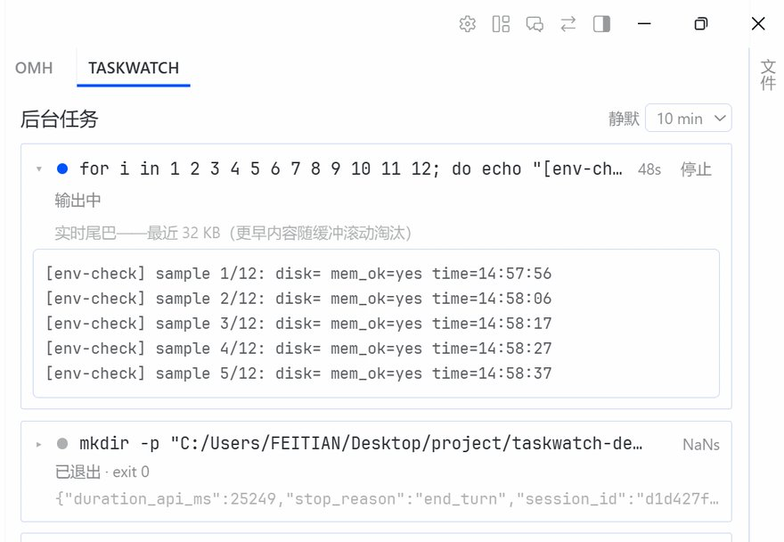
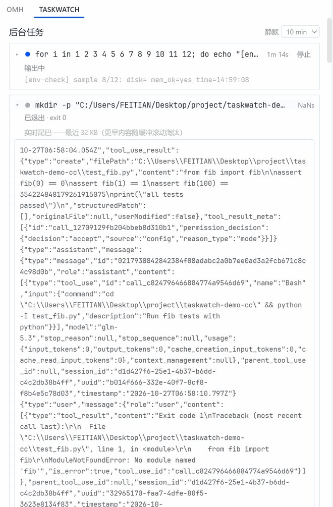

# TaskWatch


**A background-task watchboard for the [Hermes Agent](https://github.com/NousResearch/hermes-agent) desktop app.**
Every process your chat dispatches through `terminal(background=true)` — **claude, opencode, codex, zcode, a build, a test run, anything** — rendered as a live roster with output tail, runtime, a silence heartbeat and OS notifications.

> 你派出去的后台编码代理（cc / opencode / codex / 任何终端进程）在干什么、有没有卡死，一块面板看清。

| At a glance | |
|---|---|
| Agent-agnostic | watches the **terminal-process layer**, not any agent's transcript format |
| Desktop-only | one file, no build step, no dependencies, nothing leaves the machine |
| Install | copy `desktop/plugin.js`, reload plugins — see [Install](#install) |
| Releases | fully automated from commit titles — see [Releases](#releases-automated) |

## Screenshots



*The watchboard pane: one row per dispatched background process, with runtime, status and the latest output line.*



*Expanded row: the append-only live tail — scrollable history while the task keeps running.*

## Why

Dispatching a coding agent in the background answers "is it running?" but not **"what is it doing, is it stuck, did it finish?"** — and each agent has its own transcript format. TaskWatch watches at the **terminal-process layer** instead: it renders the gateway's own `process.list` projection for the live sessions, so it is agent-agnostic by construction.

## Features

- **All-chats roster** — by default the pane lists **every live chat's** background tasks in one place, grouped by conversation (chat title + running count), with an *All chats / This chat* filter. The status-bar chip and silence alerts are global too.
- **Live roster pane** — one row per background process: command, runtime, last output line, status dot
- **Silence heartbeat** — a running task whose output stops changing shows `silent N min`; configurable threshold (5/10/20/30 min)
- **OS notifications** — task goes silent past the threshold, or exits (success/failure by exit code) → native toast (fires while you are away from Hermes; in-app toast otherwise)
- **Stop button** — two-click confirm, goes through the gateway's `process.kill` verb and only reaches processes a chat owns
- **Expandable output** — click a row to expand a scrollable view of the most recent 32 KB of output (agent thinking included when the agent prints it to the terminal); mouse-wheel through it while the task keeps running
- **Status-bar chip** — running count, hidden while idle, highlighted when something is silent past the threshold; **click to reveal the pane** (same `host.revealPane` gesture as the OMH status item)
- **English + 中文**

## Install

1. Copy `desktop/plugin.js` into your Hermes desktop-plugins folder, named by the plugin id:

   ```
   <hermes home>/desktop-plugins/taskwatch/plugin.js
   ```

   (`%LOCALAPPDATA%\hermes\desktop-plugins\taskwatch\plugin.js` on Windows, `~/.hermes/desktop-plugins/taskwatch/plugin.js` by default otherwise.)

2. In the desktop app, run **Reload desktop plugins** from the command palette (⌘K / Ctrl+K). The pane appears on the right; drag it anywhere.

No build step, no dependencies, nothing to compile. **Updating** = re-copy `plugin.js` from the latest [release](https://github.com/Joclto/hermes-taskwatch/releases) and reload; the desktop code is only loaded at plugin (re)load.

## How it works

- Data: the gateway's `session.active_list` + `process.list` session RPCs — the live runtime session ids the process projection is keyed by, which is also what the desktop dock renders.
- Heartbeat: TaskWatch compares the process output tail between polls; an unchanged tail while the process is running means silence. Silence is a heuristic — a quiet build is not a stuck build — which is why it surfaces **"silent N min"** (possible wait-for-input or stall) rather than claiming failure.
- Failure is not "empty": a roster that cannot be fetched, or a session whose processes cannot be listed, is reported as an error/partial state — never rendered as "no tasks".
- Notifications: in-app toast always; native OS toast (fired by the plugin, gated by Settings ▸ Notifications ▸ "Plugin notifications") so you hear about a stalled or finished task while working in another window.
- Stop: the gateway's `process.kill` session verb, which refuses any process the chat does not own.

**Privacy:** everything is local. The pane reads the process projection for live sessions; nothing is written, exported or sent anywhere; no model tokens are spent.

## Watching a dispatched Claude Code task

`claude -p` holds its output until the end, so a dispatched task looks silent in any watchboard. Stream it instead, piped through the bundled pretty-filter:

```bash
claude -p "task" \
  --output-format stream-json --verbose \
  --dangerously-skip-permissions \
| python tools/cc-stream-pretty.py
```

The filter renders one readable line per completed block — `[think]`, `[tool]`, `[result]`, `[say]`, `[done]` — in real time, which the TaskWatch tail then surfaces live. Leave `--include-partial-messages` off: token-level deltas would flood a rolling tail. The full session still lands in `~/.claude/projects/**/**.jsonl`, and `claude agents` / `claude attach <id>` cover the interactive replay.

## Contributing: issues & pull requests

### Issues

- **Bug** — Hermes version, desktop OS, what you dispatched (the command), what the pane showed vs. what you expected. A screenshot of the row (or the expanded output) is worth a hundred words.
- **Feature** — describe the *workflow* you want ("I want to see X when Y happens"), not just the UI; TaskWatch deliberately stays at the process layer, so say whether your idea fits there.
- **Third-party PRs are welcome** — [#1](https://github.com/Joclto/hermes-taskwatch/pull/1) came from the community and shipped as v0.2.2.

### Pull requests

1. Branch from `main`; one PR = one change.
2. **Title follows [Conventional Commits](https://www.conventionalcommits.org)** — the release bot reads it (see below): `feat: …`, `fix: …`, `docs: …`, `refactor: …`, `test: …`, `chore: …`; scope in parentheses is fine, e.g. `fix(desktop): query tasks with live session IDs`.
3. Merge with **squash** and keep the PR title as the squash commit message — that line is what triggers the version bump.
4. Keep the plugin desktop-only and dependency-free: no build step, no network, no model calls; data stays on the machine.

## Releases (automated)

Nobody edits version numbers by hand. Every push to `main` runs [`.github/workflows/auto-release.yml`](.github/workflows/auto-release.yml):

| Commit titles since the last tag | Version bump | Example |
|---|---|---|
| `feat!:` or `BREAKING CHANGE` in the body | **major** | 0.2.2 → 1.0.0 |
| `feat:` | **minor** | 0.2.2 → 0.3.0 |
| `fix:` | **patch** | 0.2.2 → 0.2.3 |
| only `chore / docs / refactor / test / ci …` | **no release** | — |

When a bump is due the workflow updates `plugin.yaml` and `catalog/taskwatch.yaml` (version **and** the pinned commit sha), tags `vX.Y.Z`, and publishes a [GitHub Release](https://github.com/Joclto/hermes-taskwatch/releases) listing the commits — so catalog installs (which compare the pinned sha) and git installs both see the update. Release commits themselves never re-trigger the workflow.

## Scope & roadmap

- Shipped (v0.2.x): all-chats roster with per-chat grouping and the All/This-chat filter; global chip and alerts; live-session roster fix.
- Candidate next: loop detection (same tool + same arguments repeated, as `hermes-monitor` does for kanban workers), click-through to the matching terminal tab, opt-in tee-to-file dispatch for full history beyond the 32 KB projection.

## License

MIT — see [LICENSE](LICENSE).
